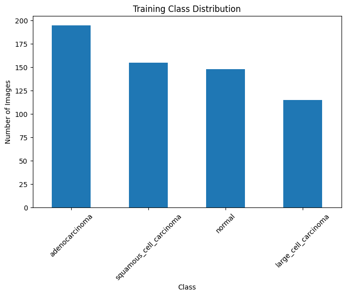
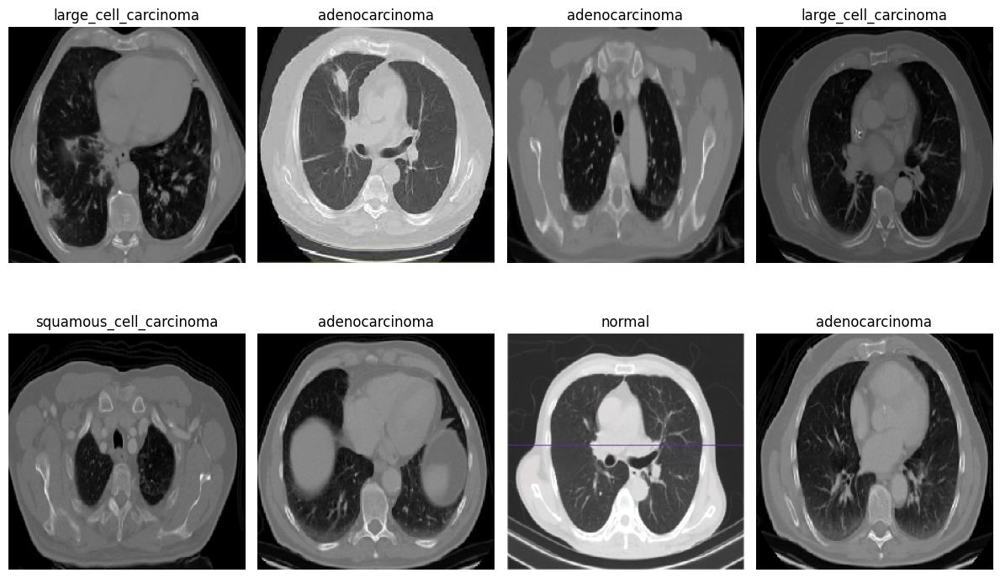
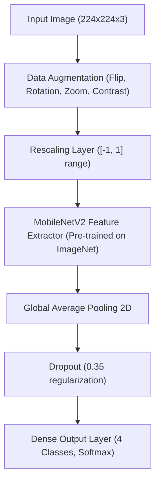
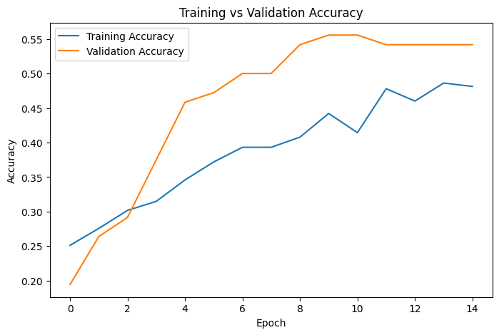
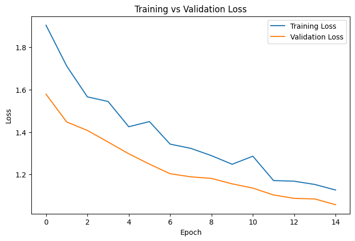
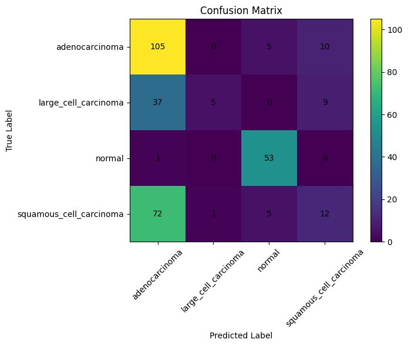
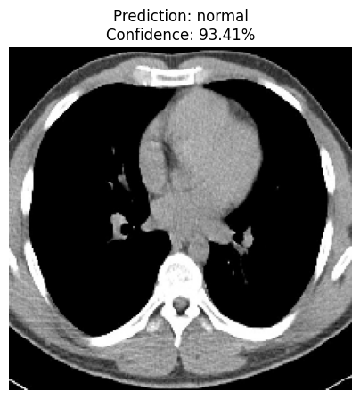
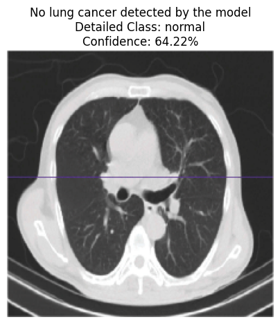

# 🫁 Pulmonary Disease & Chest CT/X-Ray Classification

[](https://www.python.org/)
[](https://tensorflow.org/)
[](https://keras.io/)
[]()
[](LICENSE)

An end-to-end Deep Learning system to automatically classify pulmonary diseases and detect lung malignancies from Chest CT scan and X-Ray images using Convolutional Neural Networks (CNNs) and Transfer Learning.

---

## 📌 Project Overview & Highlights
* **Automated Diagnostic Screening**: Multi-class classification of chest scans into 4 clinical categories: **Adenocarcinoma**, **Large Cell Carcinoma**, **Squamous Cell Carcinoma**, and **Normal (Healthy Lung Tissue)**.
* **Transfer Learning Architecture**: Built on top of **MobileNetV2** (pre-trained on ImageNet), fine-tuned with custom pooling, dropout regularization, and dense classification layers.
* **Overfitting Mitigation & Augmentation**: Integrated real-time data augmentation (horizontal flips, zoom, rotations, and contrast variations) combined with balanced class weighting to handle class imbalances.
* **Diagnostic Inference & Web UI**: Includes interactive prediction scripts and a **Streamlit Web Application** for drag-and-drop diagnostic review and confidence scoring.

---

## 🔬 Dataset Overview

The dataset is sourced from the [Kaggle Chest CT-Scan Images Dataset](https://www.kaggle.com/datasets/mohamedhanyyy/chest-ctscan-images) containing partitioned medical images across three subsets:

| Split | Number of Images | Description |
| :--- | :--- | :--- |
| **Train** | 613 | Used for training with real-time augmentation |
| **Validation** | 72 | Used for hyperparameter tuning & early stopping |
| **Test** | 315 | Held-out set for final evaluation |

### Classes & Distribution
* **Adenocarcinoma**: Most common type of lung cancer.
* **Large Cell Carcinoma**: Fast-growing and aggressive malignant cells.
* **Squamous Cell Carcinoma**: Originates in the central airway bronchi.
* **Normal**: Unremarkable, healthy lung tissue without malignant lesions.



### Sample Medical Scans


---

## 🧠 Model Architecture & Methodology



### Key Training Techniques
1. **Transfer Learning**: Utilized pre-trained MobileNetV2 weights for rich anatomical feature representations with reduced training compute.
2. **Class Imbalance Handling**: Applied `compute_class_weight` dynamically during model training to penalize minority misclassifications.
3. **Adaptive Callbacks**:
   - `ModelCheckpoint`: Saves only weights that achieve peak validation accuracy.
   - `EarlyStopping`: Halts training if validation loss stagnates for 4 consecutive epochs, restoring the best-performing weights.

---

## 📊 Experimental Results

### Training & Validation Curves
| Accuracy Progression | Loss Progression |
| :---: | :---: |
|  |  |

### Confusion Matrix & Evaluation


```
                         precision    recall  f1-score   support

         adenocarcinoma       0.49      0.88      0.63       120
   large_cell_carcinoma       0.83      0.10      0.18        51
                 normal       0.84      0.98      0.91        54
squamous_cell_carcinoma       0.39      0.13      0.20        90

               accuracy                           0.56       315
              macro avg       0.64      0.52      0.48       315
           weighted avg       0.58      0.56      0.48       315
```

### Sample Diagnostic Inference
The model produces both granular multi-class probabilities and a high-level summary (Normal vs Malignancy Suspected):




---

## 🗂️ Project Structure

```
chest-xray-disease-classification/
├── assets/                          # Extracted charts, plots & sample scans for documentation
│   ├── class_distribution.png
│   ├── dataset_samples.png
│   ├── accuracy_curve.png
│   ├── loss_curve.png
│   ├── confusion_matrix.png
│   ├── prediction_sample_1.png
│   └── prediction_sample_2.png
├── notebooks/                       # Interactive Jupyter / Colab notebooks
│   └── Chest_XRay_Classification.ipynb
├── src/                             # Modular Python source code
│   ├── __init__.py
│   ├── dataset.py                   # Data ingestion, preprocessing & tf.data pipeline
│   └── model.py                     # MobileNetV2 architecture & augmentation layers
├── app.py                           # Interactive Streamlit Web Demo
├── predict.py                       # CLI inference script for new scans
├── train.py                         # Standalone model training script
├── requirements.txt                 # Python dependencies
├── .gitignore                       # Git ignore file (prevents dataset/weight bloat)
└── README.md                        # Documentation
```

---

## 🚀 Getting Started

### 1. Clone the Repository
```bash
git clone https://github.com/YOUR_USERNAME/chest-xray-disease-classification.git
cd chest-xray-disease-classification
```

### 2. Create and Activate Virtual Environment
```bash
# Windows
python -m venv venv
venv\Scripts\activate

# macOS/Linux
python3 -m venv venv
source venv/bin/activate
```

### 3. Install Dependencies
```bash
pip install -r requirements.txt
```

### 4. Running the Interactive Streamlit Web App
```bash
streamlit run app.py
```
Open your browser at `http://localhost:8501` to upload chest scans and view instant diagnostic predictions!

### 5. Running Prediction via Command Line
```bash
python predict.py --image path/to/sample_scan.png --model best_model.keras --show
```

### 6. Training the Model Locally
Download the dataset from [Kaggle](https://www.kaggle.com/datasets/mohamedhanyyy/chest-ctscan-images) and extract it into a `data/` folder:
```
data/
  ├── train/
  ├── valid/
  └── test/
```
Then run:
```bash
python train.py --data_dir data --epochs 15 --batch_size 32
```

---

## ⚠️ Medical Disclaimer
*This project is developed solely for research, academic, and portfolio demonstration purposes. It is not approved as a clinical medical device. All diagnostic decisions must be rendered by certified medical radiologists and physicians.*

---

## 👤 Author
- **Anjum**
- GitHub: [ANJUM](https://github.com/anjumsaif002)
